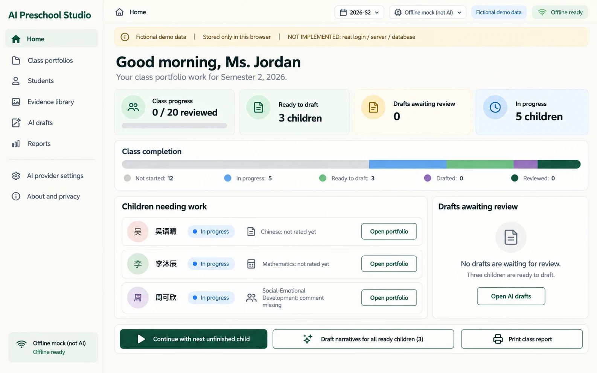
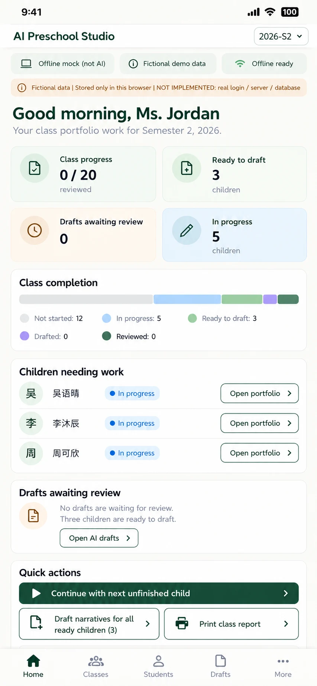

# P01 — Home
Route: #/ · Menu item: Home · User: educator · Purpose: decide the next class task and resume it quickly.
This is a working dashboard, not a marketing hero or student-record feed.
## Wireframes
 
## Regions (top to bottom, left to right; numbered)
1. AppShell: SidebarNav, TopBar (“AI Preschool Studio”, “Home”, “2026-S2”, provider/PWA status) and DemoNotice (“Fictional demo data”, “Stored only in this browser”, “NOT IMPLEMENTED: real login / server / database”).
2. PageHeader: “Good morning, Ms. Jordan”; secondary line “Your class portfolio work for Semester 2, 2026.”
3. MetricCard row: “Class progress” with “0 / 20 reviewed”; “Ready to draft” with “3 children”; “Drafts awaiting review” with “0”; “In progress” with “5 children”.
4. ProgressBar section: “Class completion”; StatusChip counts “Not started: 12”, “In progress: 5”, “Ready to draft: 3”, “Drafted: 0”, “Reviewed: 0”.
5. Main work queue, heading “Children needing work”: ChildRow examples 吴语晴, 李沐辰 and 周可欣 with “In progress”, compact domain status and link “Open portfolio”.
6. PanelCard “Drafts awaiting review”: “No drafts are waiting for review.” and “Three children are ready to draft.”; link/button “Open AI drafts”.
7. ActionGroup: PrimaryButton “Continue with next unfinished child”; SecondaryButton “Draft narratives for all ready children (3)”; SecondaryButton “Print class report”.
## Data shown (fields, from which existing module/function)
Use the class seed, not index.html's separate five-student/session-only showcase: CHILDREN and seedRecords() in src/portfolio-seed.js, classProgress(), computeStatus() and nextChildNeedingWork() in src/portfolio-model.js. P01 dashboard counts reflect the current 2026-S2 seed (12 not started, 5 in progress, 3 ready; 0 drafted/reviewed). Real-time totals update after local record changes.
## Actions and navigation (what each control does, where it goes)
Continue opens the next unfinished child in P03. Open portfolio opens that child's P03 route. Open AI drafts goes to P07; with zero drafts it shows an empty state and a link to P02 ready-to-draft children. Draft narratives for all ready children runs the currently selected provider only after explicit activation. Print class report opens P08 with class and current semester preselected.
## States (empty, loading, error, offline, long content, 20 children)
Show skeleton metrics until local records resolve; show zeroed, labelled progress for a truly empty class; a full class has 20 records. Drafts panel has a clear empty state; provider failures preserve current content and show retry/provider action. Offline mode keeps local browsing/editing available and offers Offline mock only as an explicit choice. Save failure is visible as “Not saved”.
## Responsive behaviour (what changes at 390 px)
Use a two-by-two MetricCard grid, compact ChildRows and a two-column secondary ActionGroup below the full-width primary action. Keep all quick actions clear of the fixed MobileTabBar; content gets safe-area padding and scrolls vertically as needed. The persistent DemoNotice carries the safety copy; no duplicate footer notice. No horizontal scroll.
## Accessibility notes
Use one h1 and ordered section headings; make counts text-readable; progress has an accessible name/value; keyboard focus follows the selected action; announce saved/draft errors; never encode status using color alone.
## Implementation mapping
Implemented in `class.html` at `#/`.
- `src/studio/pages/home.js`: exported `render`.
- `src/studio/models/home-model.js`: exported `homeModel`.
- Shared routing: `src/studio/router.js` (`parseRoute`, `buildRoute`); shell: `src/studio/shell.js` (`mountShell`, `navigationModel`); styles: `studio.css` and `src/studio/tokens.css`.

## Implementation notes / deviations
Print class report opens P08 with the shared semester but no class-type query parameter; Reports initially selects Child report. This differs from the specified class preselection.

## Acceptance checks (5-8 testable bullets)
- The page opens on class work with no large marketing hero.
- The sample S2 counts read 0 / 20 reviewed, 3 ready to draft, 0 drafts awaiting review and 5 in progress.
- Continue opens the next child that is not reviewed in P03.
- The empty drafts panel links to P07 and provides a path back to ready children.
- Class action counts update after a local record is edited or reviewed.
- At 390 px, sections stack, bottom tabs stay usable and no horizontal overflow occurs.
