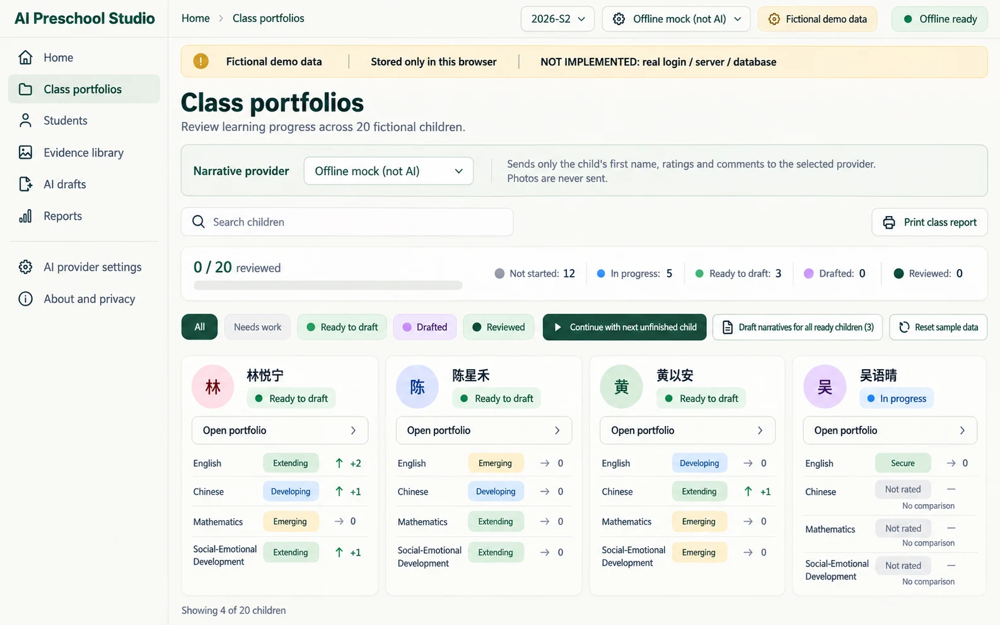
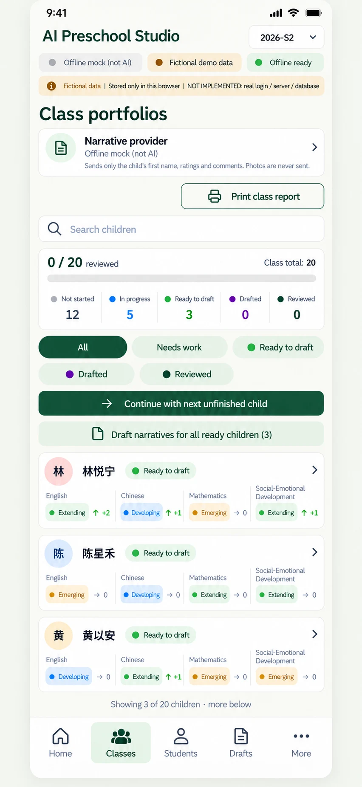

# P02 — Class portfolios
Route: #/classes · Menu item: Class portfolios · User: educator · Purpose: scan all 20 fictional portfolios, find unfinished work and open one child.
One shared-shell page for S1/S2 progress, search, filters and class actions.
## Wireframes
 
## Regions (top to bottom, left to right; numbered)
1. AppShell: SidebarNav, TopBar (“Class portfolios”, semester switch “2026-S1” / “2026-S2”, provider/PWA status) and DemoNotice (“Fictional demo data”, “Stored only in this browser”, “NOT IMPLEMENTED: real login / server / database”).
2. PageHeader: “Class portfolios”; supporting copy “Review learning progress across 20 fictional children.”
3. ProviderCard: “Narrative provider”, “Offline mock (not AI)”, disclosure “Sends only the child's first name, ratings and comments to the selected provider. Photos are never sent.”, connection “not tested”.
4. Toolbar: SearchField (“Search children”), SecondaryButton “Print class report”.
5. ProgressBar summary: “0 / 20 reviewed”; StatusChip counts “Not started: 12”, “In progress: 5”, “Ready to draft: 3”, “Drafted: 0”, “Reviewed: 0”.
6. FilterChips: “All”, “Needs work”, “Ready to draft”, “Drafted”, “Reviewed”.
7. ActionGroup: PrimaryButton “Continue with next unfinished child”; SecondaryButton “Draft narratives for all ready children (3)”; SecondaryButton “Reset sample data”.
8. ChildCard grid: 20 records; first visible examples 林悦宁, 陈星禾, 黄以安 and 吴语晴. Show initials, portfolio StatusChip, four domains, current rating/readiness and S2 comparison where S1 rating exists; link “Open portfolio”.
9. InlineNotice: “Fictional demonstration only. Not an approved school system. Printed portfolios contain teacher-reviewable drafts, not assessments.”
## Data shown (fields, from which existing module/function)
CHILDREN and seedRecords() in src/portfolio-seed.js; classProgress(), computeStatus(), progressComparison() in src/portfolio-model.js; filterChildren(), domainDot() and STATUS_LABELS in src/class-view.js; records load/save through src/portfolio-store.js. Sample S2 seed has 12 not started, 5 in progress, 3 ready to draft and none drafted/reviewed.
## Actions and navigation (what each control does, where it goes)
Semester changes update all counts, domain comparisons and cards. Search filters names; status chips filter derived portfolio state. Continue opens the next unfinished C-01–C-20 route. Open portfolio goes to P03 with child and semester. Draft narratives for all ready children explicitly runs the selected provider; failures/rejections stay visible and never silently switch to mock. Print class report opens the class report preview. Reset requires confirmation and restores fictional seed data only.
## States (empty, loading, error, offline, long content, 20 children)
Show loading skeleton while records load; show “No children match this search.” with a clear-search action; show saved/not-saved status for localStorage. Remote drafting is disabled offline with “Offline: select Offline mock or reconnect before remote drafting.” Keep rejected domains visible for retry/manual writing. Long names wrap; 20 children remain one-column on mobile and four-column maximum on desktop.
## Responsive behaviour (what changes at 390 px)
Hide SidebarNav for MobileTabBar. Stack provider, semester/search controls, progress, filters and actions. ProviderCard keeps the concise disclosure “Sends only the child's first name, ratings and comments. Photos are never sent.” ChildCard becomes a full-width row with four readable domain labels; actions wrap, controls stay at least 44 px and no horizontal scroll is allowed.
## Accessibility notes
Use one h1; label semester/search; expose selected filters with aria-pressed; announce save/draft results; give progress a text value; pair every domain state/color with a word/icon; preserve keyboard focus after filtering.
## Implementation mapping
Implemented in `class.html` at `#/classes`.
- `src/studio/pages/classes.js`: exported `render` and `classesModel`.
- Shared routing: `src/studio/router.js` (`parseRoute`, `buildRoute`); shell: `src/studio/shell.js` (`mountShell`, `navigationModel`); styles: `studio.css` and `src/studio/tokens.css`.

## Implementation notes / deviations
Print class report links directly to `#/print-class?sem=…`. At widths up to 600 px, domain labels are visually abbreviated to EN/ZH/MA/SE; full labels remain in the accessible content.

## Acceptance checks (5-8 testable bullets)
- With the sample seed at 2026-S2, the summary reads 0 / 20 reviewed and 12 / 5 / 3 / 0 / 0 across the five statuses.
- S1/S2 selection updates ratings and comparisons; missing S1 reads “No comparison”.
- Search and all five filters can be used by keyboard and announce an empty result.
- The child grid renders all 20 fictional records without horizontal overflow at 390 px.
- Provider failure leaves existing narratives intact and never changes to mock without selection.
- Reset sample data requires confirmation and changes only local fictional records.
- Every card opens the matching child and selected semester.
