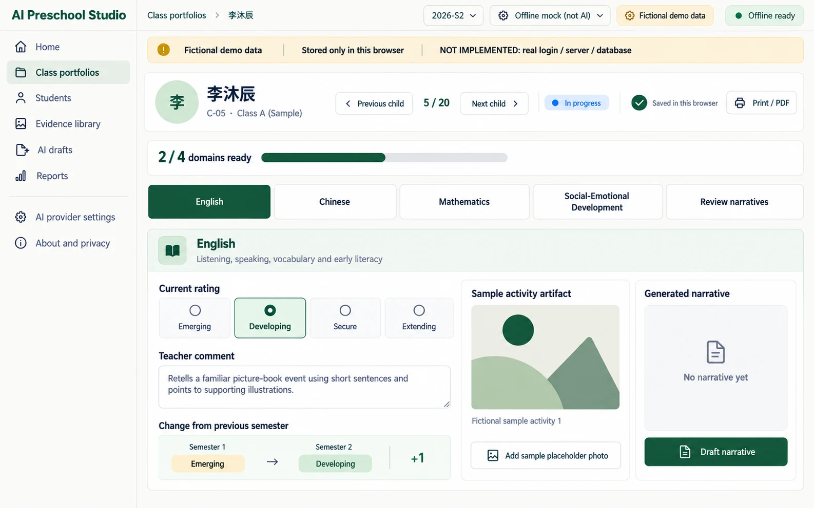
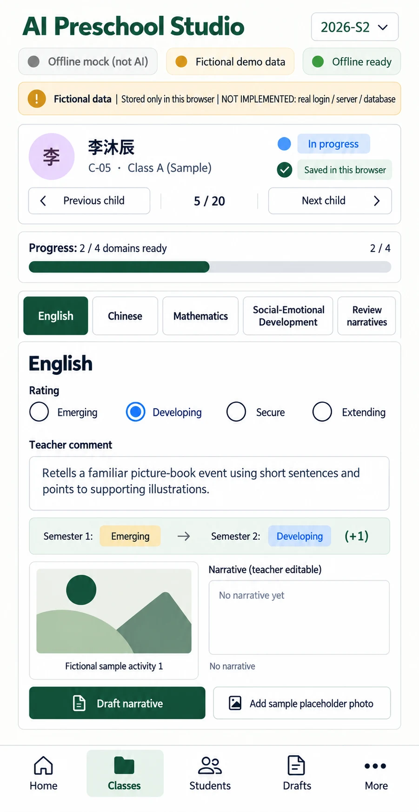

# P03 — Child portfolio editor
Route: `#/classes/class-a/children/C-05?sem=2026-S2` · Menu item: child of Class portfolios · User: educator · Purpose: complete one child's four-domain record and review source-labelled narratives.
The editor keeps one domain in view at a time; the final step reviews all four narratives.
## Wireframes
 
## Regions (top to bottom, left to right; numbered)
1. AppShell: SidebarNav, TopBar breadcrumb “Class portfolios / Ellis B.”, semester switch “2026-S1” / “2026-S2”, provider/PWA status, and DemoNotice: “Fictional demo data”, “Stored only in this browser”, “NOT IMPLEMENTED: real login / server / database”.
2. Sticky PageHeader: “Ellis B.”, “C-05 · Class A (Sample)”, a collapsed “Edit child name” disclosure with labelled free-form “Child name” input and “Save name”, SecondaryButton “Previous child”, “5 / 20”, SecondaryButton “Next child”, StatusChip “In progress”, and save status “Saved in this browser”.
3. ProgressBar: “2 / 4 domains ready”; the current S2 record has English and Chinese ratings plus comments.
4. DomainTabs: “English” (selected), “Chinese”, “Mathematics”, “Social-Emotional Development”, “Review narratives”. Keep exactly one domain panel visible.
5. PanelCard “English”: RatingControl with “Developing” selected; FormField “Teacher comment” containing “Retells a familiar picture-book event using short sentences and points to supporting illustrations.”; S2 comparison “Semester 1: Emerging → Semester 2: Developing (+1)”; PhotoTile abstract placeholder with required alt text “Fictional sample activity 1”.
6. NarrativeBox: “Narrative (teacher editable)”, empty helper “No narrative yet”, source label “No narrative”, and PrimaryButton “Draft narrative”. After generation show exactly “MOCK DRAFT (offline, not AI)” or “AI DRAFT (provider) - teacher must review”.
7. ActionGroup: SecondaryButton “Add sample placeholder photo”; final Review narratives step shows all four source labels, editable text, stale/rejected notices and PrimaryButton “Mark reviewed and go to next child” (disabled until all four narratives are nonempty).
## Data shown (fields, from which existing module/function)
CHILDREN/C-05 and seedRecords() in src/portfolio-seed.js; domain rating, comment, photos and narrative from the selected 2026-S2 record; S1 baseline and change from progressComparison() and narrativeInputFor() in src/portfolio-model.js. C-05 defaults to Ellis B.: English Emerging → Developing (+1), Chinese Emerging → Emerging (0), Mathematics and Social-Emotional Development not rated in S2 (S1 Extending). Names are browser-local identity overrides shared across semesters; all twenty defaults are fictional English names, with Unicode-derived initials. Photo alt text comes from the seed record.
## Actions and navigation (what each control does, where it goes)
DomainTabs switch the visible panel; Review narratives opens the final step. Rating/comment/photo edits autosave to localStorage and clear the reviewed flag; changed existing narratives become stale. Add sample placeholder photo requires alt text and explicit Save photo. Draft narrative uses the selected provider; failures keep existing text and never silently switch to mock. Previous/Next changes the child while preserving the semester. Review advances to the next unfinished child; Print / PDF opens P08 with C-05 selected.
Save name trims and NFC-normalizes a fictional name, accepts 1–60 Unicode code points and rejects control/format characters. Duplicates are allowed with a warning; child IDs remain distinct and unchanged. Enter submits; Escape restores the current name. Names persist in the existing portfolio-store envelope and update identity headings, breadcrumbs, lists, reports and future masked prompts. Existing teacher evidence and narrative prose remain verbatim; changing the name clears review and marks existing narratives stale for manual review/regeneration. Name changes are disabled while drafting; storage failure retains the in-memory name and exposes Retry save.
## States (empty, loading, error, offline, long content, 20 children)
Show Skeleton while local records load; show “Not saved: storage unavailable” if persistence fails and retain edits. Missing rating/comment stays empty and does not count as a ready domain. Remote drafting offline shows “Offline: select Offline mock or reconnect before remote drafting.” Rejected domains keep their rejection reason and retry/manual edit actions. Narrative limit is 2000 characters; comment limit is 1000; a domain allows up to six photos.
## Responsive behaviour (what changes at 390 px)
Hide SidebarNav for MobileTabBar. Keep the child PageHeader and ProgressBar visible while scrolling the single PanelCard. “Edit child name” starts collapsed to keep the sticky header compact; expanding it lets the form grow naturally without clipping its controls or feedback. DomainTabs wrap to two rows within their labelled region; rating choices and photo tiles wrap vertically, with no horizontal page scrolling. Leave safe space above the fixed bottom tabs.
## Accessibility notes
Use one h1, labelled DomainTabs with selected state, fieldset/legend for RatingControl, persistent FormField labels, required alt text, live save/draft feedback and visible focus. Do not convey ratings or status by color alone; honor reduced motion.
## Implementation mapping
Implemented at the root in `index.html` at `#/classes/class-a/children/:id?sem=2026-S2`.
- `src/studio/pages/child-editor.js`: exported `render`.
- `src/studio/editor-model.js`: exported `editorModel`; domain and narrative controls are composed by the page.
- Shared routing: `src/studio/router.js` (`parseRoute`, `buildRoute`); shell: `src/studio/shell.js` (`mountShell`, `navigationModel`); styles: `studio.css` and `src/studio/tokens.css`.

## Implementation notes / deviations
Print / PDF opens P09 directly, not P08. The legacy child hash redirects to the canonical editor route.

## Acceptance checks (5-8 testable bullets)
- Opening the route selects C-05, 2026-S2, English, and shows “5 / 20”.
- Exactly one domain panel is visible; Review narratives is a distinct final step.
- S2 shows S1 comparison for every domain, including “Not rated in Semester 2”.
- Saving a photo requires nonempty alt text; the preview uses abstract placeholder art only.
- Offline or failed AI drafting preserves the current narrative and its source label.
- A changed narrative is marked stale and a successful local save reads “Saved in this browser”.
- Name edits survive navigation, semester changes and reload; Unicode names remain intact, invalid names do not commit and duplicates warn without blocking.
- At 390 px all controls remain reachable above MobileTabBar without horizontal overflow.
