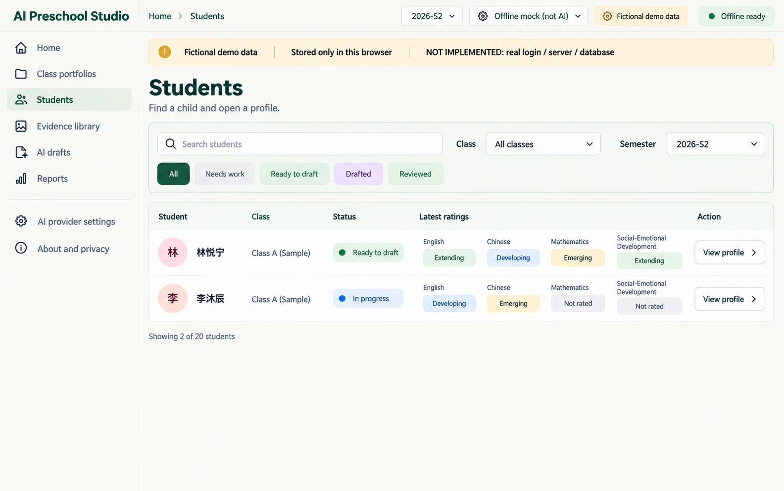
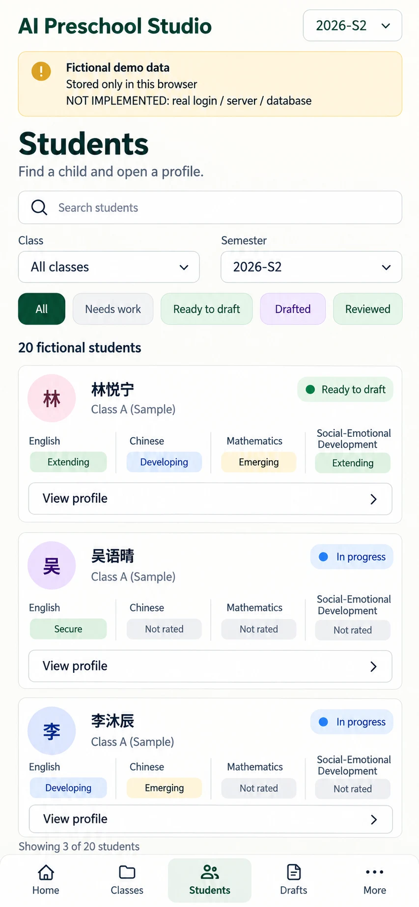

# P04 — Students directory
Route: `#/students` · Menu item: Students · User: educator · Purpose: find one of 20 fictional children and open that child's profile.
This is a roster view with current-semester status and latest domain ratings.
## Wireframes
 
## Regions (top to bottom, left to right; numbered)
1. AppShell: SidebarNav, TopBar breadcrumb “Students”, semester switch “2026-S1” / “2026-S2”, provider/PWA status, and DemoNotice: “Fictional demo data”, “Stored only in this browser”, “NOT IMPLEMENTED: real login / server / database”.
2. PageHeader: “Students”; supporting copy “Find a child and open a profile.”
3. Toolbar: SearchField “Search students”; FormField “Class” set to “All classes”; FormField “Semester” set to “2026-S2”; FilterChips “All”, “Needs work”, “Ready to draft”, “Drafted”, “Reviewed”.
4. PanelCard “20 fictional students”: ChildRow list with columns “Student”, “Class”, “Status”, “Latest ratings”. First rows: 林悦宁 — Ready to draft — English Extending, Chinese Developing, Mathematics Emerging, Social-Emotional Development Extending; 李沐辰 — In progress — English Developing, Chinese Emerging, Mathematics Not rated, Social-Emotional Development Not rated.
5. Each ChildRow has SecondaryButton “View profile”; footer copy “Showing 2 of 20 students” for the visible filtered example.
## Data shown (fields, from which existing module/function)
CHILDREN, seedRecords() and CLASS in src/portfolio-seed.js; semester record status from computeStatus(), latest domain rating from record.domains, and labels from STATUS_LABELS/domainDot() in src/portfolio-model.js and src/class-view.js. The only seeded class is “Class A (Sample)”; “All classes” and “Class A (Sample)” are the filter options.
## Actions and navigation (what each control does, where it goes)
SearchField filters fictional names; Class and Semester update the roster; FilterChips filter derived record status. Selecting a ChildRow or “View profile” opens P05 at `#/students/C-05`. Opening a child editor remains available from P05. No assignment or access-control action is implied.
## States (empty, loading, error, offline, long content, 20 children)
Show Skeleton while records load; show EmptyState “No students match these filters.” with SecondaryButton “Clear filters”; show ErrorState with retry if local records cannot load. Status counts and latest ratings derive from selected semester; missing values read “Not rated”. Long names wrap and all 20 records remain available by vertical scrolling. Offline browsing remains local.
## Responsive behaviour (what changes at 390 px)
Hide SidebarNav for MobileTabBar. Stack SearchField and filters above full-width ChildRows; each row places name/status first and wraps four rating labels below. Keep filter controls at least 44 px high and avoid horizontal table scrolling.
## Accessibility notes
Use a labelled search input and labelled select controls; expose FilterChips with aria-pressed. Use semantic row headings and links/buttons with the child's name in the accessible name. Status includes text/icon as well as color; preserve focus after filtering.
## Implementation mapping
Implemented at the root in `index.html` at `#/students`.
- `src/studio/pages/students.js`: exported `render`.
- `src/studio/models/students-model.js`: exported `studentsModel`.
- Shared routing: `src/studio/router.js` (`parseRoute`, `buildRoute`); shell: `src/studio/shell.js` (`mountShell`, `navigationModel`); styles: `studio.css` and `src/studio/tokens.css`.

## Implementation notes / deviations
The footer derives its count from all matching records, not a fixed two-row image example. At widths up to 600 px, visible domain labels use EN/ZH/MA/SE; full labels remain accessible.

## Acceptance checks (5-8 testable bullets)
- The default roster contains 20 fictional children from the class seed.
- Search, class, semester and all five status filters update the visible ChildRows.
- C-05 at 2026-S2 shows In progress with two rated domains and two “Not rated” domains.
- Selecting “View profile” for 李沐辰 opens `#/students/C-05`.
- Empty filters show “No students match these filters.” and a working clear action.
- At 390 px the roster is readable without horizontal overflow.
