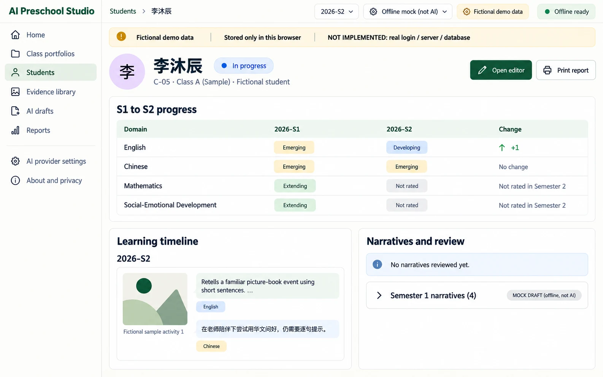
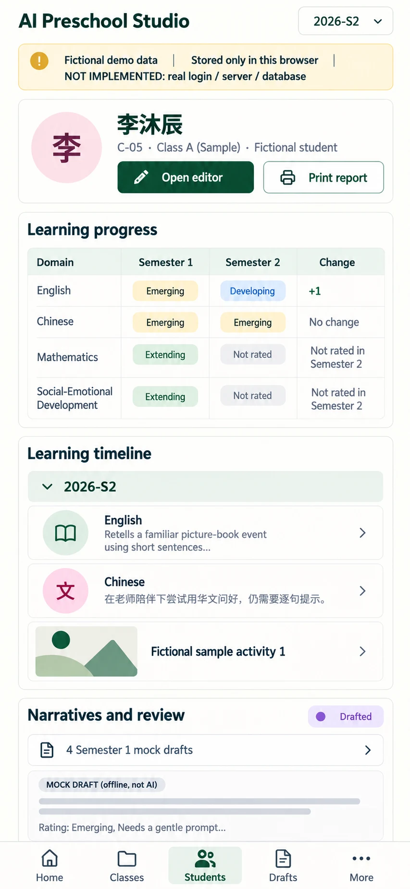

# P05 — Student profile
Route: `#/students/C-05` · Menu item: child of Students · User: educator · Purpose: compare one child's S1/S2 ratings and review their evidence and narrative history.
The profile is a read-first summary with clear routes into editing and reporting.
## Wireframes
 
## Regions (top to bottom, left to right; numbered)
1. AppShell: SidebarNav, TopBar breadcrumb “Students / 李沐辰”, semester switch “2026-S1” / “2026-S2”, provider/PWA status, and DemoNotice: “Fictional demo data”, “Stored only in this browser”, “NOT IMPLEMENTED: real login / server / database”.
2. PageHeader: “李沐辰”; supporting copy “C-05 · Class A (Sample) · Fictional student”; ActionGroup PrimaryButton “Open editor” and SecondaryButton “Print report”.
3. PanelCard “S1 to S2 progress”: a four-row comparison table with columns “Domain”, “2026-S1”, “2026-S2”, “Change”. English: Emerging → Developing (+1); Chinese: Emerging → Emerging (No change); Mathematics: Extending → Not rated in Semester 2; Social-Emotional Development: Extending → Not rated in Semester 2.
4. PanelCard “Learning timeline”: group entries by semester because source records have no individual event dates. Show the two S2 comments: English “Retells a familiar picture-book event using short sentences and points to supporting illustrations.”; Chinese “在老师陪伴下尝试用华文问好，仍需要逐句提示。” Show PhotoTile with abstract art and alt text “Fictional sample activity 1”.
5. PanelCard “Narratives and review”: StatusChip “Drafted”; four 2026-S1 NarrativeBox excerpts carry “MOCK DRAFT (offline, not AI)”. InlineNotice “No narratives reviewed yet.” S2 has no narratives.
## Data shown (fields, from which existing module/function)
CHILDREN/C-05, seedRecords(), S1/S2 domain ratings/comments/photos/narratives from src/portfolio-seed.js; progressComparison() and record status from src/portfolio-model.js; source copy from narrativeChip() in src/class-view.js. The initial C-05 seed has four S1 mock narratives but no reviewed flag; S2 has two rated/commented domains and no narrative.
## Actions and navigation (what each control does, where it goes)
“Open editor” opens P03 at C-05 with the current semester. “Print report” opens P08 with child C-05 selected. Evidence items link to P03 with their semester/domain selected. Profile content is read-only; edits and local review happen in P03.
## States (empty, loading, error, offline, long content, 20 children)
Show Skeleton while the two semester records load; show “Not rated in Semester 2” when current evidence is absent, never zero. Show “No narratives reviewed yet.” when review flag is false; label seeded mock drafts as drafts. If no photos/comments exist, show EmptyState “No evidence recorded for this semester.” Long comments expand within the timeline; offline profile remains readable from local data.
## Responsive behaviour (what changes at 390 px)
Hide SidebarNav for MobileTabBar. Stack PageHeader actions; convert the comparison table to four PanelCard rows with S1, S2 and change labels; timeline entries and NarrativeBox use one column. Keep the editor/print actions above the fixed tab bar.
## Accessibility notes
Use one h1 and semantic table headers on desktop; each mobile comparison row repeats explicit semester labels. Narrative sources and review state are text, not color-only. Give PhotoTile alt text and keyboard-reachable editor/report actions.
## Implementation mapping
Implemented at the root in `index.html` at `#/students/:id`.
- `src/studio/pages/student-profile.js`: exported `render`.
- `src/studio/models/profile-model.js`: exported `profileModel`, `profileComparison`.
- Shared routing: `src/studio/router.js` (`parseRoute`, `buildRoute`); shell: `src/studio/shell.js` (`mountShell`, `navigationModel`); styles: `studio.css` and `src/studio/tokens.css`.

## Acceptance checks (5-8 testable bullets)
- C-05 shows four S1/S2 comparison rows with +1, no change and two missing-S2 states accurately represented.
- S2 comments and the sample photo alt text match the seeded record.
- Seeded S1 narratives are labelled “MOCK DRAFT (offline, not AI)” and are not called reviewed.
- Missing review state reads “No narratives reviewed yet.”
- “Open editor” and “Print report” open the matching child and semester in their next modules.
- At 390 px comparisons and timeline stack without horizontal overflow.
