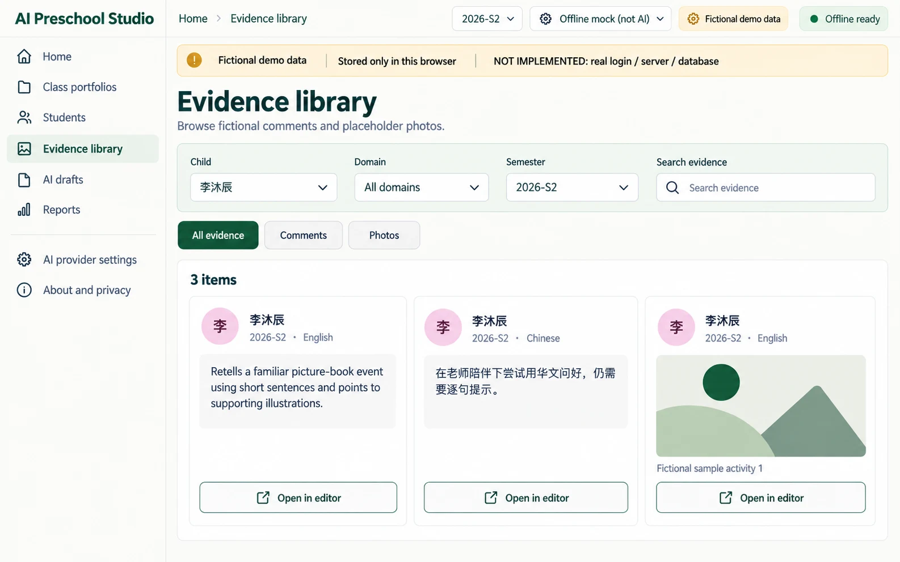
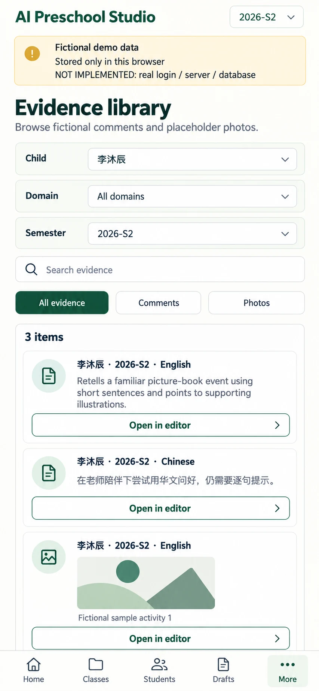

# P06 — Evidence library
Route: `#/evidence` · Menu item: Evidence library · User: educator · Purpose: browse fictional teacher comments and abstract placeholder photos by child, domain and semester.
Each evidence item links back to its source domain in the child editor.
## Wireframes
 
## Regions (top to bottom, left to right; numbered)
1. AppShell: SidebarNav, TopBar breadcrumb “Evidence library”, semester switch “2026-S1” / “2026-S2”, provider/PWA status, and DemoNotice: “Fictional demo data”, “Stored only in this browser”, “NOT IMPLEMENTED: real login / server / database”.
2. PageHeader: “Evidence library”; supporting copy “Browse fictional comments and placeholder photos.”
3. Toolbar: FormField “Child” set to “李沐辰”; FormField “Domain” set to “All domains”; FormField “Semester” set to “2026-S2”; FilterChips “All evidence”, “Comments”, “Photos”; SearchField “Search evidence”.
4. PanelCard “3 items”: two comment cards and one PhotoTile, each labelled “李沐辰 · 2026-S2”. English comment “Retells a familiar picture-book event using short sentences and points to supporting illustrations.”; Chinese comment “在老师陪伴下尝试用华文问好，仍需要逐句提示。”; abstract placeholder photo with alt text “Fictional sample activity 1”.
5. Each item includes its domain label (“English” or “Chinese”) and SecondaryButton “Open in editor”.
## Data shown (fields, from which existing module/function)
Per-domain `comment` and `photos[{id, alt, src}]` from the selected C-05 2026-S2 record in src/portfolio-seed.js and src/portfolio-model.js. The photo is generated by placeholderPhoto() as abstract SVG art. The model stores semester and domain but no individual evidence date; do not show invented event dates.
## Actions and navigation (what each control does, where it goes)
Child, Domain, Semester and type FilterChips narrow the list; SearchField searches comment text and alt text. “Open in editor” opens P03 with the source child, semester and domain selected. Photo previews never open or upload an external image and are never sent to a provider.
## States (empty, loading, error, offline, long content, 20 children)
Show Skeleton while local records load; show EmptyState “No evidence matches these filters.” and SecondaryButton “Clear filters”; show ErrorState if local storage cannot be read. Empty comments and absent photos create no evidence item. Long comments wrap; 20 children remain selectable. Offline browsing remains available from local records.
## Responsive behaviour (what changes at 390 px)
Hide SidebarNav for MobileTabBar. Stack the four filters and SearchField; display comments and PhotoTile in a single column. Wrap domain labels and actions below item content, keep controls at least 44 px, and prevent horizontal overflow.
## Accessibility notes
Give each filter a persistent label; expose selected FilterChips with aria-pressed. Use semantic headings for each evidence item, retain photo alt text, and make “Open in editor” names include child/domain. Do not use color alone for domain or type.
## Implementation mapping
Implemented in `class.html` at `#/evidence`.
- `src/studio/pages/evidence.js`: exported `render`.
- `src/studio/models/evidence-model.js`: exported `evidenceModel`.
- Shared routing: `src/studio/router.js` (`parseRoute`, `buildRoute`); shell: `src/studio/shell.js` (`mountShell`, `navigationModel`); styles: `studio.css` and `src/studio/tokens.css`.

## Implementation notes / deviations
The initial filter selects all children in the shared semester, not C-05. Selecting C-05 reproduces the specified evidence example.

## Acceptance checks (5-8 testable bullets)
- Child, domain, semester, type and text filters can be combined and cleared.
- The C-05 S2 filter shows two comments and one abstract sample photo with matching alt text.
- No individual date is displayed when the record contains no event date.
- “Open in editor” returns to the source child, semester and domain.
- No face, real photo, real identity or provider upload appears in the page.
- At 390 px all filters and evidence items fit without horizontal scrolling.
