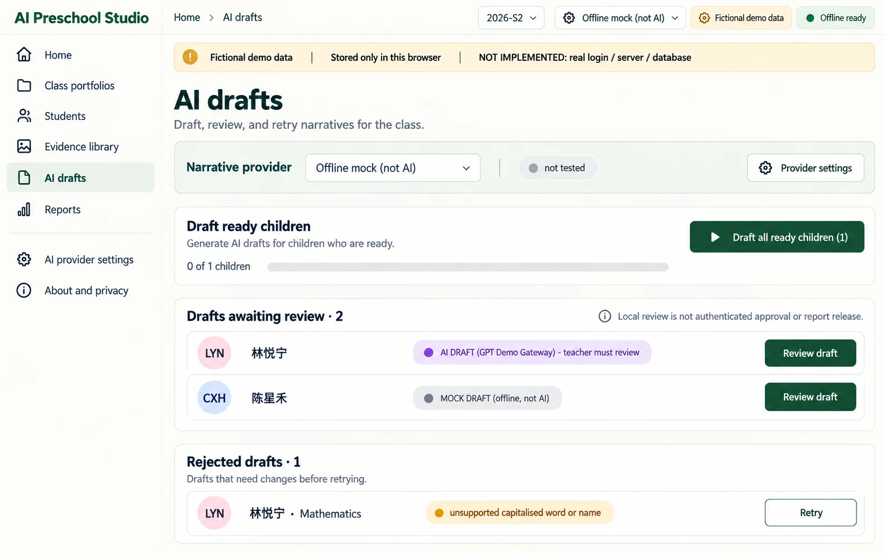
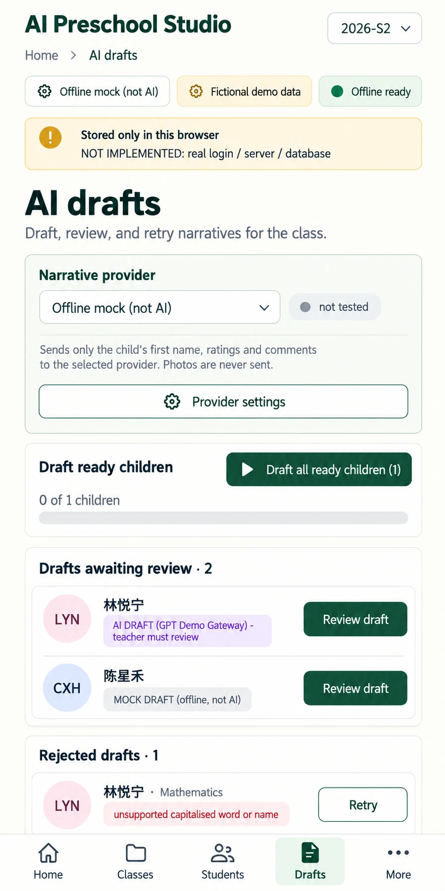

# P07 — AI drafts
Route: `#/drafts` · Menu item: AI drafts · User: educator · Purpose: run narrative drafts, review their sources and recover rejected domains.
The populated wireframe is an illustrative mixed-provider state; initial S2 seed data has 0 drafts, 3 ready children and 5 in progress.
## Wireframes
 
## Regions (top to bottom, left to right; numbered)
1. AppShell: SidebarNav, TopBar (“AI drafts”, “2026-S2”, provider status, “Fictional demo data”, “Offline ready”) and DemoNotice (“Stored only in this browser”, “NOT IMPLEMENTED: real login / server / database”).
2. PageHeader: “AI drafts”; supporting copy “Draft, review, and retry narratives for the class.”
3. ProviderCard: “Narrative provider”, “Offline mock (not AI)”, “not tested” and SecondaryButton “Provider settings”.
4. PanelCard “Draft ready children”: PrimaryButton “Draft all ready children (1)”; ProgressBar with “0 of 1 children” at rest and “n of m children” while running.
5. PanelCard “Drafts awaiting review · 2”: ChildRow “林悦宁” with “AI DRAFT (GPT Demo Gateway) - teacher must review” and PrimaryButton “Review draft”; ChildRow “陈星禾” with “MOCK DRAFT (offline, not AI)” and PrimaryButton “Review draft”.
6. PanelCard “Rejected drafts · 1”: “林悦宁 · Mathematics”; reason “unsupported capitalised word or name”; SecondaryButton “Retry”.
7. InlineNotice: “Review each narrative against teacher evidence. Local review is not authenticated approval or report release.”
## Data shown (fields, from which existing module/function)
Use CHILDREN and seedRecords() from src/portfolio-seed.js; computeStatus(), classProgress() and narrativeInputFor() from src/portfolio-model.js; narrativeChip(), STATUS_LABELS and PROVIDER_LABELS from src/class-view.js; provider selection and rejection reasons from src/class-app.js and src/narrative.js. The populated rows illustrate drafts created after explicit generation; do not seed or persist these examples.
## Actions and navigation (what each control does, where it goes)
Draft all ready children uses only the selected provider, updates “n of m children”, and stops visibly on a request failure while preserving completed children. Retry invokes the selected provider for the rejected domain; it never silently substitutes mock text. Review draft opens P03 at Review narratives. Mark reviewed remains available there only after all four narratives exist; it is local demo state.
## States (empty, loading, error, offline, long content, 20 children)
Initial queue is empty and links to Class portfolios filtered to Ready to draft. Rejected domains retain visible reason and retry/manual-edit path. Remote drafting while offline is disabled with “Offline: select Offline mock or reconnect before remote drafting.” Show “Not saved” on storage failure; support all 20 children with a scrollable queue.
## Responsive behaviour (what changes at 390 px)
Use MobileTabBar with Drafts active. Stack provider, run progress, review queue and rejected list; make each ChildRow full width and keep Retry/Review draft at least 44 px. No horizontal scroll.
## Accessibility notes
Announce run progress and errors with live status text; pair every source and state color with its exact text label. Keep keyboard order aligned with queue order and show focus.
## Implementation mapping (existing files/functions to reuse; new files proposed; hash route)
Reuse src/class-app.js draft(), providerControls() and draftButton(), src/class-view.js narrativeChip(), src/portfolio-model.js status functions, and src/narrative.js rejection validation. Add shared-shell route `#/drafts`; rejection map is currently memory-only. Display the requested shorter “GPT Demo Gateway” provenance label in place of the current “(public demo session)” suffix.
## Acceptance checks (5-8 testable bullets)
- The page shows exact AI and MOCK provenance labels on every queued draft.
- The run action reflects the current ready-child count and exposes “n of m children”.
- A rejected row shows its reason and a Retry action.
- Provider errors preserve existing narratives and never create a mock draft implicitly.
- Review draft opens the correct child and semester in P03.
- Mark reviewed is described as local and requires four narratives.
- At 390 px the queue stacks without horizontal overflow or undersized controls.
