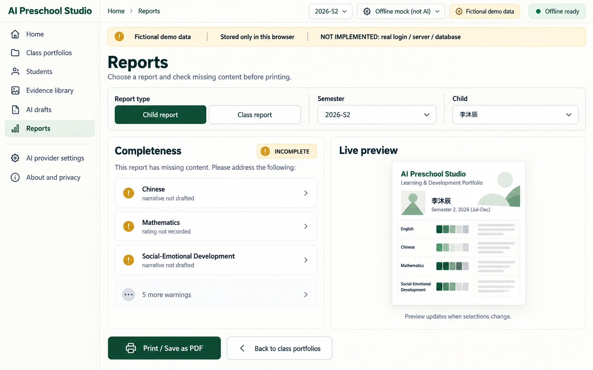
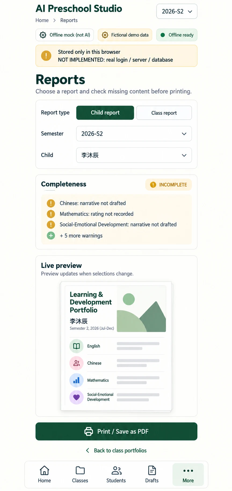

# P08 — Reports
Route: `#/reports` · Menu item: Reports · User: educator · Purpose: select a child or class report, check completeness and print a preview.
The preview reflects the selected semester and live record completeness before browser printing.
## Wireframes
 
## Regions (top to bottom, left to right; numbered)
1. AppShell: SidebarNav, TopBar (“Reports”, “2026-S2”, provider/PWA status) and DemoNotice (“Fictional demo data”, “Stored only in this browser”, “NOT IMPLEMENTED: real login / server / database”).
2. PageHeader: “Reports”; supporting copy “Choose a report and check missing content before printing.”
3. Toolbar: labelled report-type control “Child report” / “Class report”; FormField “Semester” with “2026-S1” and “2026-S2”; conditional FormField “Child” with “李沐辰” for Child report.
4. PanelCard “Completeness”: StatusChip “INCOMPLETE”; warnings “Chinese: narrative not drafted”, “Mathematics: rating not recorded”, “Social-Emotional Development: narrative not drafted” and “5 more warnings”.
5. PanelCard “Live preview”: small A4 thumbnail headed “Learning & Development Portfolio”, “李沐辰”, “Semester 2, 2026 (Jul-Dec)” and four domain rows; label “Preview updates when selections change.” Class report preview shows “20 fictional children”.
6. ActionGroup: PrimaryButton “Print / Save as PDF”; SecondaryButton “Back to class portfolios”.
## Data shown (fields, from which existing module/function)
Child preview uses CHILDREN, current and previous semester records, buildReport() from src/report-model.js, and renderReport() from src/report-view.js. Completeness warnings come from report.status.warnings. The class route renders one report per child through the existing `#/print-class?sem=2026-S2` flow.
## Actions and navigation (what each control does, where it goes)
Child report shows the child selector and opens `#/print/C-05?sem=2026-S2` for 李沐辰. Class report hides the child selector and opens `#/print-class?sem=2026-S2`. Semester changes refresh warnings and preview. Print / Save as PDF remains available for incomplete reports; the print page retains its visible INCOMPLETE notice.
## States (empty, loading, error, offline, long content, 20 children)
Show a Skeleton while records load. A missing child or record gives an explicit empty/incomplete preview, never invented content. Include all 20 children in class output; long reports may paginate naturally. Printing remains local and works offline after records load.
## Responsive behaviour (what changes at 390 px)
Use MobileTabBar with More active. Stack the selectors, warnings and preview; show Print / Save as PDF as a full-width action above the fixed tab bar with safe-area spacing. No horizontal scroll.
## Accessibility notes
Use labelled single-select controls, a heading for completeness warnings, semantic warning text and a readable thumbnail caption. Print action and preview links remain keyboard reachable.
## Implementation mapping (existing files/functions to reuse; new files proposed; hash route)
Reuse src/report-model.js buildReport(), src/report-view.js renderReport()/renderReportControls(), and src/class-app.js child and class print routes. Add shared-shell `#/reports` selector and preview route; no server-side PDF is implied.
## Acceptance checks (5-8 testable bullets)
- Users can select Child report or Class report and 2026-S1 or 2026-S2.
- Child report exposes a child selector; Class report shows the 20-child preview.
- Selecting 李沐辰 in S2 shows “Chinese: narrative not drafted” when no narrative exists.
- Preview and warnings update with the selected child and semester.
- Print / Save as PDF opens the matching child or class print route.
- Incomplete records remain printable with their warning visible.
- At 390 px all controls and the preview fit without horizontal overflow.
