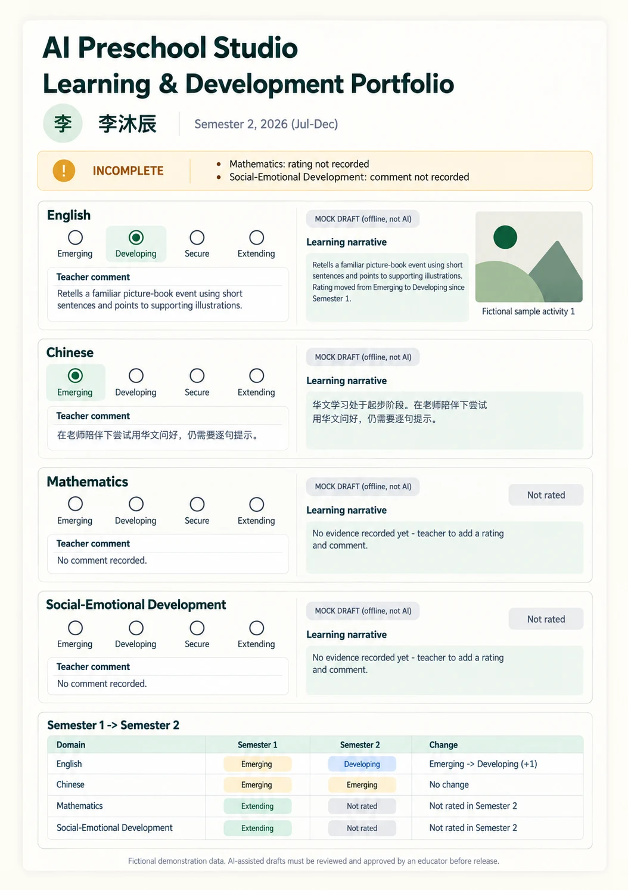

# P09 — Report print layout
Route: `#/print/C-05?sem=2026-S2` · Menu item: output of Reports · User: educator · Purpose: inspect and print one fictional child report.
This is an A4 portrait post-draft sample for 李沐辰; absent S2 evidence remains explicitly missing.
## Wireframes

## Regions (top to bottom, left to right; numbered)
1. Print controls outside the paper: PrimaryButton “Print / Save as PDF” and SecondaryButton “Back”. The A4 page itself has no app navigation.
2. Report header: “AI Preschool Studio”, “Learning & Development Portfolio”, child “李沐辰”, “Semester 2, 2026 (Jul-Dec)”.
3. InlineNotice “INCOMPLETE”: concise missing-item list includes “Mathematics: rating not recorded” and “Social-Emotional Development: comment not recorded”.
4. Four compact domain sections each show four rating segments “Emerging”, “Developing”, “Secure”, “Extending”, a comment, narrative and source “MOCK DRAFT (offline, not AI)”. English is Developing; comment “Retells a familiar picture-book event using short sentences and points to supporting illustrations.”; narrative “Retells a familiar picture-book event using short sentences and points to supporting illustrations. Rating moved from Emerging to Developing since Semester 1.” Chinese is Emerging; comment “在老师陪伴下尝试用华文问好，仍需要逐句提示。”; narrative “华文学习处于起步阶段。在老师陪伴下尝试用华文问好，仍需要逐句提示。” Mathematics and Social-Emotional Development are Not rated; each says “No comment recorded.” and “No evidence recorded yet - teacher to add a rating and comment.”
5. PhotoTile in English: abstract geometric placeholder with caption “Fictional sample activity 1”; no faces or real photos.
6. Progress table caption “Semester 1 -> Semester 2”; columns “Domain”, “Semester 1”, “Semester 2”, “Change”. Rows: English Emerging -> Developing (+1); Chinese Emerging -> Emerging (No change); Mathematics Extending -> Not rated; Social-Emotional Development Extending -> Not rated.
7. Footer disclaimer: “Fictional demonstration data. AI-assisted drafts must be reviewed and approved by an educator before release.”
## Data shown (fields, from which existing module/function)
李沐辰 is C-05 in CHILDREN/seedRecords() from src/portfolio-seed.js. S2 has English and Chinese ratings/comments and one abstract English photo; Mathematics and Social-Emotional Development are empty. S1 supplies all four comparison ratings. Mock narratives come from mockNarrative() and retain the exact MOCK source label. Report fields and warning text come from buildReport() in src/report-model.js.
## Actions and navigation (what each control does, where it goes)
Print / Save as PDF calls the browser print dialog; Back returns to the selected report configuration. The print document is read-only and does not approve or edit narratives.
## States (empty, loading, error, offline, long content, 20 children)
Keep incomplete warnings in screen and print output. No-evidence domains show “Not rated”, “No comment recorded.” and the no-evidence narrative. Long text flows onto additional A4 pages without clipping; class output remains the separate 20-child route.
## Responsive behaviour (what changes at 390 px)
The P09 route may be previewed on a phone, where the paper scales to viewport width and controls stack above it. Browser print uses A4 portrait regardless of screen size; no sideways page scrolling.
## Accessibility notes
Use semantic report headings, table caption and scoped headers; set Simplified Chinese text to `zh-Hans`. The four rating segments include their text labels and selected state.
## Implementation mapping
Implemented in `class.html` at `#/print/:id?sem=2026-S2; #/print-class?sem=2026-S2`.
- `src/studio/pages/print.js`: exported `render` and `printModel`.
- `src/studio/models/reports-model.js`: exported `reportsModel`.
- Shared routing: `src/studio/router.js` (`parseRoute`, `buildRoute`); shell: `src/studio/shell.js` (`mountShell`, `navigationModel`); styles: `studio.css` and `src/studio/tokens.css`.

## Implementation notes / deviations
Back returns to the child editor for a child report and Class portfolios for class output, not the previous Reports configuration.

## Acceptance checks (5-8 testable bullets)
- The wireframe shows one A4 portrait report with all four domain sections.
- 李沐辰 and “Semester 2, 2026 (Jul-Dec)” appear in the header.
- Every section shows all four rating labels and an explicit selected or Not rated state.
- Comments, narrative source labels, the abstract photo caption and S1-to-S2 table are visible.
- The exact disclaimer appears in the footer.
- Missing S2 inputs stay labelled; no unsupported rating or observation is invented.
- Long copy paginates without clipping or removing the disclaimer.
