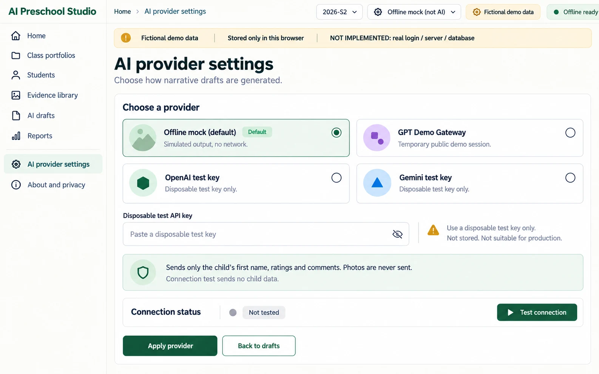
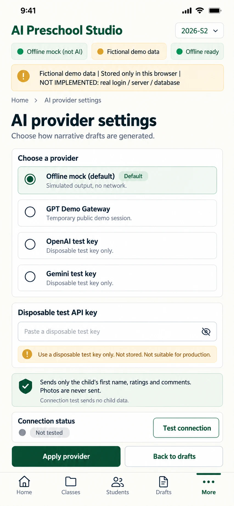

# P10 — AI provider settings
Route: `#/settings/ai` · Menu item: AI provider settings · User: educator · Purpose: choose a narrative provider and inspect its disclosure and connection state.
This full page replaces the current provider dialog and makes disposable-key handling visible. The wireframes show OpenAI selected to expose its conditional key field; first-use selection remains Offline mock.
## Wireframes
 
## Regions (top to bottom, left to right; numbered)
1. AppShell: SidebarNav, TopBar (“AI provider settings”, “2026-S2”, provider/PWA status) and DemoNotice (“Fictional demo data”, “Stored only in this browser”, “NOT IMPLEMENTED: real login / server / database”).
2. PageHeader: “AI provider settings”; supporting copy “Choose how narrative drafts are generated.”
3. PanelCard “Choose a provider”: four ProviderCards — “Offline mock (default)” with a “Default” chip; “GPT Demo Gateway”; “OpenAI test key” selected; “Gemini test key”. Each states whether it is simulated, a temporary demo session or a direct test-key request.
4. Conditional FormField “Disposable test API key” (password, autocomplete off) for OpenAI/Gemini with placeholder “Paste a disposable test key” and exact helper “Use a disposable test key only. Not stored. Not suitable for production.”
5. InlineNotice “Sends only the child's first name, ratings and comments. Photos are never sent.”; note that a connection probe sends no child data.
6. PanelCard “Connection status”: StatusChip “not tested”; PrimaryButton “Test connection”; live result area for testing, success or sanitized failure.
7. ActionGroup: PrimaryButton “Apply provider”; SecondaryButton “Back to drafts”.
## Data shown (fields, from which existing module/function)
Provider identifiers and labels come from PROVIDER_LABELS in src/class-view.js; requests use src/providers.js and src/narrative.js. The current class app keeps provider, key and connection status in memory only; no key is stored in the portfolio record or browser storage.
## Actions and navigation (what each control does, where it goes)
Selecting a card clears any old key and resets status. Test connection runs only on explicit activation, uses a synthetic no-child probe, changes no narrative, and reports a sanitized status. Apply provider uses the selection for future drafting and returns to P07. The connection probe uses probeProviderConnection() in src/providers.js without persisting credentials.
## States (empty, loading, error, offline, long content, 20 children)
Offline mock is available without a network and labels all output as simulated. Remote providers show offline, testing, connected or failed text; failures keep existing narratives unchanged. Key is blank again when leaving the page or changing provider. Provider availability and quotas are external.
## Responsive behaviour (what changes at 390 px)
Use MobileTabBar with More active. Stack all ProviderCards, key field, disclosure and status; place Test connection and Apply provider as full-width actions. Controls remain at least 44 px and do not overflow.
## Accessibility notes
ProviderCards form a labelled single-choice group; key field has a persistent label and associated warning. Announce connection results and show status with text plus icon, never color alone.
## Implementation mapping
Implemented in `class.html` at `#/settings/ai`.
- `src/studio/pages/ai-settings.js`: exported `render`.
- `src/studio/models/settings-model.js`: exported `createSettingsModel`.
- Shared routing: `src/studio/router.js` (`parseRoute`, `buildRoute`); shell: `src/studio/shell.js` (`mountShell`, `navigationModel`); styles: `studio.css` and `src/studio/tokens.css`.

## Implementation notes / deviations
The connection probe is implemented. Leaving settings clears its input/model key; an applied provider key remains in shared page memory for drafting, until cleared or the app reloads. The key field is conditional and hidden for Offline mock.

## Acceptance checks (5-8 testable bullets)
- All four requested provider choices appear, with Offline mock selected by default.
- OpenAI/Gemini reveal a password field and the exact disposable-key warning.
- The exact child-data disclosure and “Photos are never sent.” stay visible.
- Test connection runs only on click and its probe includes no child name, ratings or comments.
- Connection success/failure is announced and does not change portfolio records.
- A test key never enters localStorage, sessionStorage, URL or logs.
- At 390 px ProviderCards and actions stack without horizontal overflow.
