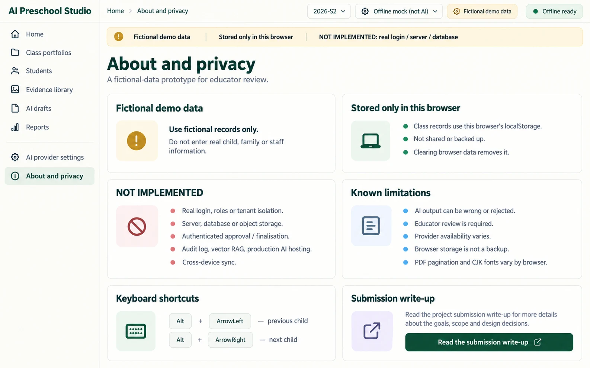
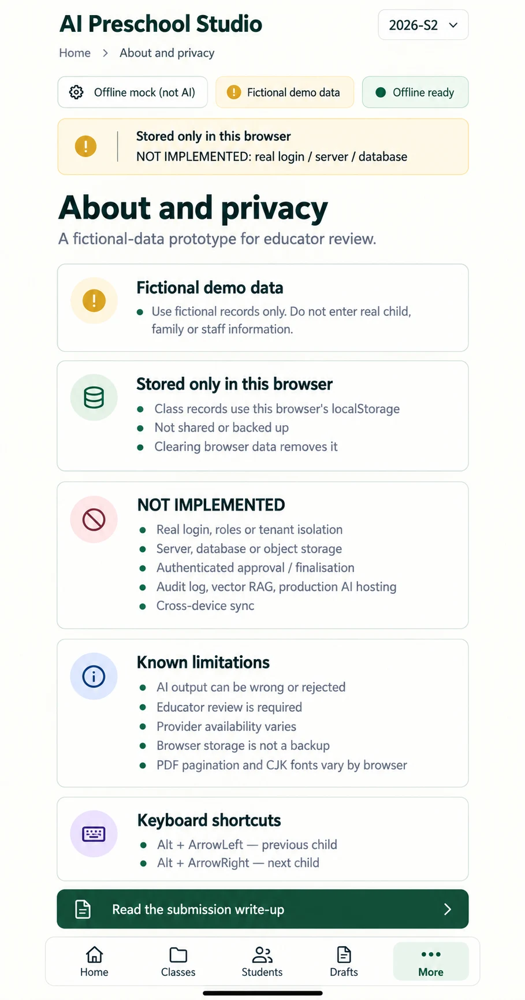

# P11 — About and privacy
Route: `#/about` · Menu item: About and privacy · User: educator · Purpose: understand what the fictional demo stores, what is not built and where its limits are.
The page offers clear privacy facts and a direct link to the project write-up.
## Wireframes
 
## Regions (top to bottom, left to right; numbered)
1. AppShell: SidebarNav, TopBar (“About and privacy”, “2026-S2”, provider/PWA status) and DemoNotice (“Fictional demo data”, “Stored only in this browser”, “NOT IMPLEMENTED: real login / server / database”).
2. PageHeader: “About and privacy”; supporting copy “A fictional-data prototype for educator review.”
3. PanelCard “Fictional demo data”: “Use fictional records only. Do not enter real child, family or staff information.”
4. PanelCard “Stored only in this browser”: explain class records use this browser’s localStorage; data is not shared or backed up, and clearing browser data removes it.
5. PanelCard “NOT IMPLEMENTED”: real login, roles or tenant isolation; server, database or object storage; authenticated approval/finalisation; audit log; vector RAG; production AI hosting; cross-device sync.
6. PanelCard “Known limitations”: AI output can be wrong or conservatively rejected; educator review is required; provider availability varies; local storage is not secure backup; print pagination and CJK fonts vary by browser.
7. PanelCard “Keyboard shortcuts”: “Alt + ArrowLeft — previous child”; “Alt + ArrowRight — next child”.
8. SecondaryButton link “Read the submission write-up” to `docs/26-submission-writeup.md`.
## Data shown (fields, from which existing module/function)
Storage and provider facts reflect src/studio/context.js, src/portfolio-store.js, src/narrative.js and src/providers.js. Known limits and non-implemented items are summarized from docs/26-submission-writeup.md; keyboard shortcuts come from src/studio/pages/child-editor.js.
## Actions and navigation (what each control does, where it goes)
The write-up link opens the configured public main-branch submission document, not an unpublished local docs file. Keyboard shortcuts navigate between adjacent children only while the P03 editor is active. Sidebar or More menu returns to any fixed route.
## States (empty, loading, error, offline, long content, 20 children)
This static reference page works offline. If the write-up cannot be opened, preserve the page and show a normal link error state. Long limitation lists scroll vertically without hiding the privacy notice.
## Responsive behaviour (what changes at 390 px)
Use MobileTabBar with More active. Stack PanelCards and make the write-up link full width; keep safe-area spacing above the fixed tabs and avoid horizontal overflow.
## Accessibility notes
Use descriptive headings, real link text and semantic lists for NOT IMPLEMENTED items. Keep privacy facts and limitations readable without relying on warning color.
## Implementation mapping
Implemented at the root in `index.html` at `#/about`.
- `src/studio/pages/about.js`: exported `render` and `writeupHref`.
- Shared routing: `src/studio/router.js` (`parseRoute`, `buildRoute`); shell: `src/studio/shell.js` (`mountShell`, `navigationModel`); styles: `studio.css` and `src/studio/tokens.css`.

## Implementation notes / deviations
writeupHref() builds a GitHub document link from the configured repository URL. Without that configuration the page shows the document path as text; it does not implement a custom link-error state.

## Acceptance checks (5-8 testable bullets)
- “Fictional demo data” and “Stored only in this browser” are visible.
- NOT IMPLEMENTED items include login, server/database and authenticated approval.
- Storage, AI-review and browser-print limitations are stated in plain language.
- Both Alt+ArrowLeft and Alt+ArrowRight shortcuts are shown accurately.
- The write-up link resolves to docs/26-submission-writeup.md.
- The page contains no real child, school or company identity.
- At 390 px cards stack above More navigation without horizontal overflow.
