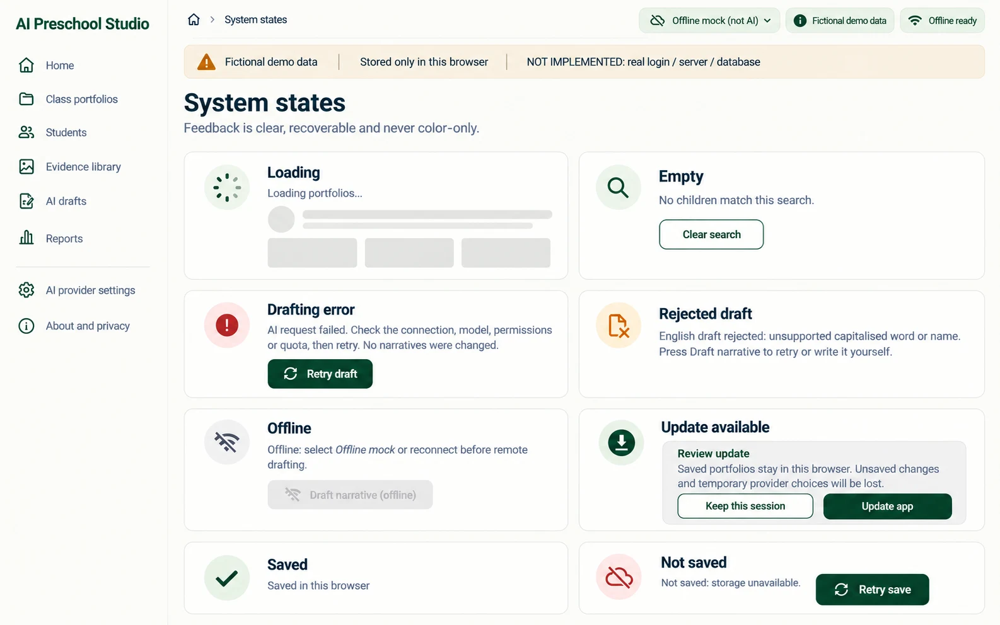

# P12 — System states
Route: reference sheet, no route · Menu item: none · User: design and implementation team · Purpose: keep feedback consistent across P01-P11.
The sheet shows shared-shell states with exact copy and recovery actions; it is not a product destination.
## Wireframes

## Regions (top to bottom, left to right; numbered)
1. AppShell and DemoNotice with “Fictional demo data”, “Stored only in this browser” and “NOT IMPLEMENTED: real login / server / database”.
2. PageHeader: “System states”; supporting copy “Feedback is clear, recoverable and never color-only.”
3. StateCard “Loading”: skeleton rows and “Loading portfolios…” with aria-busy.
4. StateCard “Empty”: “No children match this search.” and SecondaryButton “Clear search”.
5. StateCard “Drafting error”: “AI request failed. Check the connection, model, permissions or quota, then retry. No narratives were changed.” and PrimaryButton “Retry draft”.
6. StateCard “Rejected draft”: “English draft rejected: unsupported capitalised word or name.” plus “Press Draft narrative to retry or write it yourself.”
7. StateCard “Offline”: “Offline: select Offline mock or reconnect before remote drafting.” Local work remains available; remote action is unavailable.
8. StateCard “Update available”: “Update available”; action “Review update”. The shared-shell confirmation contract says “Saved portfolios stay in this browser. Unsaved changes and temporary provider choices will be lost.” Actions are “Keep this session” and “Update app”.
9. StateCard “Saved”: positive icon plus “Saved in this browser”.
10. StateCard “Not saved”: “Not saved: storage unavailable.” Keep the edited screen visible and provide “Retry save” or export/recovery guidance where available.
## Data shown (fields, from which existing module/function)
Loading comes from initialization; empty/search from class filters; provider errors/rejections from src/narrative.js and src/studio/context.js; offline/PWA state from src/pwa.js; persistence from src/portfolio-store.js. Retry save is implemented by the context and editor. Update confirmation is integrated through the studio entry and PWA controls.
## Actions and navigation (what each control does, where it goes)
Retry draft reruns the selected provider for the failed domain. Write it yourself focuses the editable narrative. Clear search resets query and filter. Review update opens the explicit confirmation, with Keep this session as a safe exit. Retry save attempts local persistence without discarding edits.
## States (empty, loading, error, offline, long content, 20 children)
All eight conditions are shown at once as isolated examples. Long errors wrap within cards. Loading skeletons keep stable geometry. Offline affects cloud generation only. A rejected domain can coexist with accepted domains. Not saved must remain distinct from Saved and remain visible until persistence succeeds.
## Responsive behaviour (what changes at 390 px)
The reference sheet reflows to one column; each card keeps heading, message and action together. It is not a horizontal carousel.
## Accessibility notes
Use role=status for non-blocking save/provider changes and role=alert for blocking failures; text labels accompany icon/color; actions are keyboard reachable and have 44 px minimum target size.
## Implementation mapping
Implemented as shared feedback components, not a standalone page or route.
- `src/studio/ui.js`: exported `stateCard`, `emptyState`, `errorState`, `loadingState`, `rejectedState`, `offlineState`, `saveState`, `pwaStatusChip`.
- `src/studio/shell.js`: exported `mountShell` wires session/offline/draft feedback.
- `src/studio/context.js`: exported `createContext` owns persistence and draft state; `src/studio/pages/child-editor.js` exported `render` exposes Retry save.
- `src/pwa.js` owns install/update controls; `studio.css` styles shared states.

## Acceptance checks (5-8 testable bullets)
- Each state has a visible heading, plain-language message and recovery action where recovery exists.
- “Saved in this browser” and “Not saved” cannot be mistaken for each other.
- Offline messaging disables remote drafting while preserving local work.
- A rejected domain can be retried or edited without hiding other accepted domains.
- Update requires an explicit review/confirmation and offers a keep-session exit.
- All examples remain readable in one column at 390 px and communicate state without color alone.
