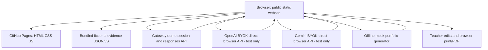
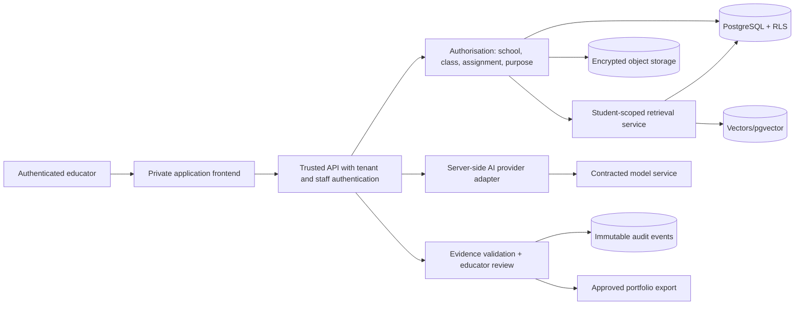

# 04 — Architecture and Trust Boundaries

## Deployed static demo (implemented)

**Trust boundary:** GitHub Pages, downloaded JavaScript and all browser-visible data are public. The teacher selector restricts *which cards are shown*, not what data a determined viewer can read. The browser is also not safe storage for user-provided long-lived secrets. No model/credential response should be treated as a source of truth without verification.

## Proposed production architecture (NOT IMPLEMENTED)

### Trust and data flow rules

- The API—not the UI—must establish user identity and tenant membership.
- Retrieval filters `tenant_id`, `student_id`, and an assignment-scope check *before* vector search and after every result; never query a global unpartitioned embedding index with only a natural language student name.
- Provider credentials are stored only in a trusted secret manager or kept session-bound in a secure backend; public BYOK remains a fictional-data developer test feature only.
- AI responses may include prompt injections or incorrect student IDs; parse strict JSON, validate IDs against the authorized retrieved evidence, require human review.
- Audit actor, student, purpose, evidence version, model version, prompt/template version, edit history, reviewer and export time without logging secret material or unnecessarily storing prompts containing child data.

### Deployment boundaries

Static: browser + GitHub Pages + public Gateway / BYOK. Production: private app with backend, database, operations, tenancy, contracts and DPO approval. The production diagram represents intent, **not existing deployed infrastructure**.
