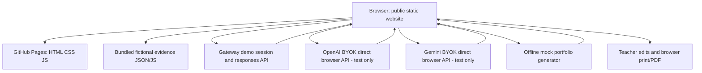
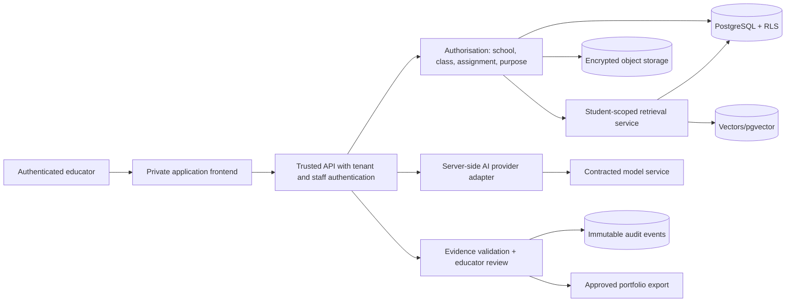

# 04 — Architecture and Trust Boundaries

## Current static studio (implemented)

The root `index.html` mounts `src/studio/app.js`, with shared router/context/shell, page renderers and pure models. `class.html` only redirects to the root while preserving hash routes. Fictional semester records, photos and narrative provenance persist through `src/portfolio-store.js` in browser `localStorage`; provider keys remain in page memory.

**Trust boundary:** GitHub Pages, downloaded JavaScript and bundled records are public. Browser filtering and local review are not authentication or authorization. Browser storage is not encrypted records storage, a backup or safe custody for long-lived secrets. Model responses require independent validation and human review.

## Proposed production architecture (NOT IMPLEMENTED)

### Trust and data flow rules

- The API—not the UI—must establish user identity and tenant membership.
- Retrieval filters `tenant_id`, `student_id`, and an assignment-scope check *before* vector search and after every result; never query a global unpartitioned embedding index with only a natural language student name.
- Provider credentials are stored only in a trusted secret manager or kept session-bound in a secure backend; public BYOK remains a fictional-data developer test feature only.
- AI responses may include prompt injections or incorrect student IDs; parse strict JSON, validate IDs against the authorized retrieved evidence, require human review.
- Audit actor, student, purpose, evidence version, model version, prompt/template version, edit history, reviewer and export time without logging secret material or unnecessarily storing prompts containing child data.

### Deployment boundaries

Static: browser + GitHub Pages + public Gateway / BYOK. Production: private app with backend, database, operations, tenancy, contracts and DPO approval. The production diagram represents intent, **not existing deployed infrastructure**.
