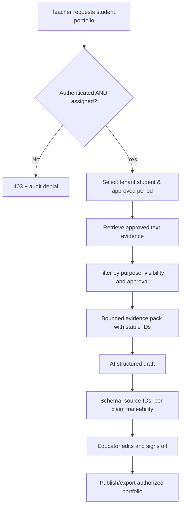

# 05 — Student Knowledge, Evidence and RAG Design

## Domain vocabulary

- **Student:** record representing a child (fictional in MVP).
- **Educator assignment:** scope limiting a teacher to specific students.
- **Observation:** timestamped evidence about actual student behavior, activities or artifacts.
- **Learning domain:** e.g. Communication, Literacy, Numeracy, Social-emotional, Creative expression; configurable for a school-defined framework.
- **Source reference:** stable observation/document/version ID supporting a narrative claim.
- **Portfolio draft:** structured generated output awaiting educator approval.
- **Review:** explicit change, comment, approval actor and timestamp.
- **Transition package:** minimal approved transfer between organizations (future).

## Current data model

`src/data.js` ships exactly 5 invented students and dated observations for a demonstration period. Each student has sample evidence IDs such as `ST-001-E01`. Editing is in memory and lost at refresh. No database, authentication or true RAG/vector search is implemented. Evidence filtering inside the JS demo is **not** production isolation.

## Production knowledge-base strategy

**One logical knowledge boundary per student** within a secure multi-tenant store, not necessarily one physical database or server per student. Suggested keys:

- `tenant_id` — operator/school boundary.
- `student_id` — stable internal GUID, never rely on child name.
- `observation_id` + `revision` — evidence provenance.
- `subject_domain` — configurable learning framework mapping.
- `consent_purpose`, `visibility`, `retention_policy`, `data_classification`.

### Proposed retrieval pipeline

### Prompt-injection safeguards

Teacher text, imported documents and OCR/transcripts are *untrusted evidence*, never model instructions. Prompts enforce use-only-supplied-evidence; the output schema is validated independently. Do not conclude correctness solely because IDs exist; the referenced evidence **must actually support the claim**. For an unsupported domain, return a neutral evidence-gap note. Never infer diagnosis, impairment, discipline or emotional state from limited evidence.

### Recommended future domain-specific AI metrics

- Evidence citation precision = backed supported claims / checked claims.
- Attribution error = cross-student claims / checked claims (**blocking if nonzero**).
- Template completeness; educator approval rate; hours spent editing; unsafe disclosure checks.
- <10% word-edit distance is an **illustrative goal**, not equivalent to 90% AI accuracy and not proven.

## Photos

Avoid face recognition for early MVP. Attach photos manually to a student ID, verify by educator, store with consent/purpose and maintain takedown/deletion ability. Biometric matching of minors requires separate necessity/security/legal review; it is not a prerequisite for student portfolio generation.
